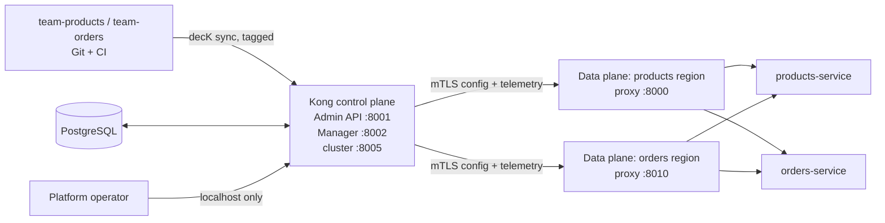

# Kong Gateway hybrid playground

This playground models a NAB-inspired enterprise topology without pretending
to be NAB infrastructure. A platform team runs one database-backed Kong
control plane and Kong Manager. Regional or cloud data planes run DB-less and
receive configuration over a mutually authenticated cluster connection. Two
service teams own their API definitions in Git and publish them through decK.

## Architecture



The control plane is the central source of truth for dynamic Admin API writes,
GUI management, and team publication. Data planes keep serving their cached
configuration when the control plane is unavailable. PostgreSQL is not
reachable by data planes or application services.

Free mode includes Kong Manager and hybrid mode. It does not provide the
enterprise tenant controls this demo intentionally avoids, such as SSO,
enterprise RBAC, and multiple workspaces. `owner:platform` and
`team:<name>` tags are therefore a teaching boundary, enforced by
[`scripts/policy-check.sh`](./scripts/policy-check.sh), not a security boundary.

## Start

Requirements: Docker Desktop, Bash (Git Bash or WSL), and Java 27 for the
Gradle check.

```bash
docker compose up --build -d
bash scripts/sync-platform.sh
bash scripts/sync-team.sh products
bash scripts/sync-team.sh orders
```

The first start generates `certs/cluster.crt` and `certs/cluster.key`. These
files are ignored and never committed. The control plane Admin API and Manager
are intentionally published on loopback only:

| Address | Purpose |
| --- | --- |
| http://localhost:8000 | products-region data plane |
| http://localhost:8010 | orders-region data plane |
| http://localhost:8001 | local-only control plane Admin API |
| http://localhost:8002 | local-only Kong Manager |

## CLI and CI/CD flow

The repository pins decK `v1.68.0` and uses its current `deck file validate`,
`deck gateway diff`, and `deck gateway sync` commands:

```bash
bash scripts/validate-team.sh products
bash scripts/diff-team.sh products
bash scripts/sync-team.sh products
bash scripts/policy-fixture-test.sh
```

The `team-products` and `team-orders` files are selected by their tags, so
syncing one team does not delete or alter the other team's entities. Platform
plugins are in [`platform/kong.yaml`](./platform/kong.yaml) and are selected
by `owner:platform`. Every team service has a `key-auth` plugin.

The pull request workflow validates both files and runs all three negative
policy fixtures. A merge to `main` additionally runs platform and team sync.
A real pipeline needs a reachable `KONG_ADMIN_URL` secret and credentials or
network access to the control plane. This local example does not configure
remote secrets.

## Try the APIs

Provision a consumer through the writable control plane. The script prints the
generated key and proves it works through both data planes without a restart:

```bash
export CONSUMER_KEY="$(bash scripts/provision-consumer.sh | awk '/API key:/ {print $3}')"
curl -i http://localhost:8000/api/products -H "X-API-Key: $CONSUMER_KEY"
curl -i http://localhost:8010/api/orders -H "X-API-Key: $CONSUMER_KEY"
```

Without a key, either route returns `401`. The platform correlation-id,
request-size, and three-requests-per-minute rate limit plugins apply globally.
The Spring services echo received gateway headers, including
`x-correlation-id` and `x-consumer-username`. A fourth request in the same
rate window returns `429`.

## Kong Manager tour

Open **http://localhost:8002** and review these pages:

1. **Gateway Services**: `products-service` and `orders-service`, each tagged
   with its team.
2. **Routes**: `products-route` and `orders-route`, with their key-auth
   plugins.
3. **Plugins**: the correlation-id, rate-limiting, and request-size-limiting
   plugins tagged `owner:platform`.
4. **Consumers**: the runtime consumer created by
   `scripts/provision-consumer.sh`, including its API key credential.

Standard open-source and enterprise Kong Manager does not include a dedicated
**Status / Clustering** tab or dashboard. Use the control plane Admin API to
verify the hybrid connection instead:

```bash
curl -fsS http://localhost:8001/clustering/data-planes
curl -fsS http://localhost:8001/clustering/status
```

The page list and what appears there should still be confirmed in the running
GUI; navigation labels can vary by Kong Gateway build.

## Resilience demo

With `CONSUMER_KEY` set, stop the control plane and send traffic through both
data planes:

```bash
bash scripts/demo-cp-outage.sh
```

The data planes continue to serve cached configuration, then the script starts
the control plane and waits for its clustering endpoint to respond.

## Verification

```bash
./gradlew build
bash scripts/policy-fixture-test.sh
bash scripts/smoke-test.sh
```

The smoke test expects Compose to be running and checks Gradle, container
health, both proxy ports, unauthenticated rejection, authenticated routing,
correlation IDs, a 429 rate-limit response, runtime provisioning, the
clustering endpoint, and Manager HTTP 200.

## Try this next

1. Add a third team directory and prove its tag isolation with `diff`.
2. Add a route to one team without touching the other team's file.
3. Change the platform rate limit through a pull request and observe both
   regions after sync.
4. Stop one data plane and compare the two proxy endpoints.
5. Rotate the runtime consumer key in Manager or with the Admin API.

## Why not DB-less everywhere?

DB-less mode is useful at the edge, but putting every Kong instance in
DB-less mode would make central GUI management and dynamic Admin API writes
awkward. Here the database-backed control plane stores the desired state and
accepts autonomous team publication, while data planes stay small, regional,
and resilient during a control-plane outage.
